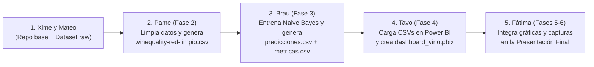

# 🍷 Predicción de la Calidad del Vino Tinto con Naive Bayes

**Materia:** Ingeniería del Conocimiento · Grupo 219900  
**Docente:** Ing. Rafael Hernández López  
**Proyecto Final:** Machine Learning (Naive Bayes) & Business Intelligence (Power BI)

---

## 🎯 1. Problemática de Negocio y Objetivo del Proyecto

### Problemática
Una bodega productora de vino tinto enfrenta pérdidas económicas debido a la variabilidad en la calidad de sus lotes al terminar la fermentación. Actualmente, la calidad (escala de 0 a 10) se evalúa de manera manual y subjetiva mediante catas sensoriales cuando el lote ya está terminado, lo que impide detectar desviaciones químicas a tiempo.

### Objetivo General
Desarrollar desde cero un modelo de clasificación probabilístico **Naive Bayes (`GaussianNB`)** que prediga si un lote de vino tinto tendrá calidad **Buena** o **Mala** a partir de sus **11 propiedades fisicoquímicas** (acidez fija, acidez volátil, ácido cítrico, azúcar residual, cloruros, dióxido de azufre libre y total, densidad, pH, sulfatos y alcohol), e integrarlo en un **Dashboard interactivo en Power BI** para que la bodega identifique lotes en riesgo antes de su distribución.

---

## 🏆 2. Todo lo que Tenemos que Alcanzar (Metas por Fase)

Para cumplir al 100 % con la rúbrica del proyecto, nuestro equipo debe construir y entregar las siguientes **6 Fases**:

### 🔹 Fase 1: Fuente y Exploración de Datos (EDA)
- [ ] Descargar y verificar el dataset oficial `winequality-red.csv` (UCI Machine Learning Repository, Cortez et al., 2009: 1,599 registros y 12 columnas).
- [ ] Explorar en Python (Jupyter o Spyder) las dimensiones, tipos de datos, estadísticas descriptivas (`describe()`) y distribución de la variable objetivo `quality`.
- [ ] Documentar el diccionario de las 12 variables explicando qué mide cada propiedad química y cómo afecta al vino (ej. exceso de acidez volátil = sabor avinagrado).
- [ ] Generar gráficas exploratorias iniciales (histograma de `quality` y matriz de correlación).

### 🔹 Fase 2: Preprocesamiento y Limpieza de Datos
- [ ] Crear un script reproducible (`scripts/preprocesamiento.py`) que cargue `data/raw/winequality-red.csv`.
- [ ] Homogenizar los nombres de las columnas (minúsculas y guiones bajos, ej. `fixed_acidity`).
- [ ] Verificar valores nulos (`isna().sum()`) y eliminar registros duplicados (`drop_duplicates()`), pasando de 1,599 a **1,359 lotes únicos**.
- [ ] Justificar el tratamiento de valores atípicos (*outliers*): por qué en control de calidad se conservan los lotes extremos.
- [ ] Transformar la variable `quality` para resolver el desbalance de clases:
  - Esquema de 3 clases (`calidad_3`: baja $\le 5$, media $= 6$, alta $\ge 7$).
  - Esquema binario (`calidad_bin`: **bueno** $\ge 6$, **malo** $\le 5$).
- [ ] Exportar el dataset limpio en `data/processed/winequality-red-limpio.csv`.

### 🔹 Fase 3: Modelado con Clasificador Naive Bayes
- [ ] Dividir los datos en entrenamiento (80 %) y prueba (20 %) con estratificación (`stratify=y`, `random_state=42`).
- [ ] Aplicar estandarización (`StandardScaler`) dentro de un `Pipeline` para evitar fuga de datos (*data leakage*).
- [ ] Entrenar el modelo **`GaussianNB`** y compararlo contra una línea base (`DummyClassifier`) y entre distintas configuraciones:
  1. Modelo con 3 clases y 11 variables.
  2. Modelo binario (`bueno` vs `malo`) con las 11 variables.
  3. Modelo binario seleccionando las mejores variables fisicoquímicas (ej. `alcohol`, `volatile_acidity`, `sulphates`).
- [ ] Evaluar con **Validación Cruzada Estratificada de 5 pliegues** (`StratifiedKFold`) y calcular **Accuracy, Precision, Recall, F1-Score y Matriz de Confusión**.
- [ ] Exportar las predicciones (`data/processed/predicciones.csv`) con probabilidades (`predict_proba`) e indicador de `lote_en_riesgo`, además de las métricas (`data/processed/metricas_modelo.csv`).

### 🔹 Fase 4: Dashboard de Inteligencia de Negocios (Power BI)
- [ ] Conectar Power BI Desktop a `data/processed/predicciones.csv` y `data/processed/metricas_modelo.csv`.
- [ ] Programar las **medidas DAX** clave (*Total Lotes*, *% Lotes Buenos*, *Lotes en Riesgo*, *% Lotes en Riesgo*, *Accuracy*, *F1 Macro*, promedios de alcohol y acidez).
- [ ] Construir un tablero interactivo de **4 páginas** con paleta color vino (`#722F37`, `#C98B92`, `#F7EFE5`):
  1. *Resumen Ejecutivo de Lotes*
  2. *Perfil Fisicoquímico (Alcohol, Acidez Volátil y Sulfatos)*
  3. *Desempeño del Modelo Naive Bayes (Matriz de Confusión y Probabilidades)*
  4. *Explorador Interactivo de Lotes en Riesgo con Segmentadores*
- [ ] Guardar el archivo `docs/dashboard/dashboard_vino.pbix` y capturas de pantalla de respaldo.

### 🔹 Fases 5 y 6: Conclusiones de Negocio, Presentación y Defensa Técnica
- [ ] Redactar la interpretación de resultados para la bodega, limitaciones del supuesto de independencia de Naive Bayes y trabajo futuro.
- [ ] Elaborar la presentación ejecutiva en PowerPoint (`docs/presentacion/Presentacion_Naive_Bayes.pptx`).
- [ ] Preparar el guion cronometrado de 30 minutos (5 min por integrante) y el banco de preguntas técnicas para la defensa (`docs/presentacion/guion.md`).

---

## 👥 3. Equipo, Ramas de Git y Guías Individuales

> 📖 **ANTES DE EMPEZAR:** Todos los integrantes deben leer primero **[`INSTRUCCIONES_GENERALES.md`](./INSTRUCCIONES_GENERALES.md)** para configurar su entorno de **Jupyter / Spyder**, entender el orden de trabajo y aprender a subir su rama a GitHub.

| Orden | Integrante | Rama en GitHub | Rol y Fase Asignada | Guía Paso a Paso (Sin IA) |
| :---: | :--- | :--- | :--- | :--- |
| **1** | **Xime** | `xime-repositorio-readme` *(o `Ximena_Equipo_4`)* | Líder de Proyecto, Estructura del Repo y Integración de PRs | [📄 Ver guía de Xime](./guias/01_xime_repositorio_y_liderazgo.md) |
| **2** | **Mateo** | `mateo-origen-datos` *(o `Mateo_Equipo_4`)* | **Fase 1:** Origen de datos, análisis exploratorio (EDA) y diccionario químico | [📄 Ver guía de Mateo](./guias/02_mateo_origen_datos.md) |
| **3** | **Pame** | `Pamela_Equipo_4` *(o `pame-preprocesamiento`)* | **Fase 2:** Limpieza de datos, duplicados, clases y exportación de CSV limpio | [📄 Ver guía de Pame](./guias/03_pame_preprocesamiento.md) |
| **4** | **Brau** | `Braulio_Equipo_4` *(o `brau-modelo-naive-bayes`)* | **Fase 3:** Entrenamiento de `GaussianNB`, métricas, validación y predicciones | [📄 Ver guía de Brau](./guias/04_brau_modelo_naive_bayes.md) |
| **5** | **Tavo** | `octavio` *(o `Octavio_Equipo_4`)* | **Fase 4:** Medidas DAX y construcción del Dashboard en Power BI | [📄 Ver guía de Tavo](./guias/05_tavo_dashboard_bi.md) |
| **6** | **Fátima** | `fatima-presentacion-defensa` *(o `Fatima_Equipo_4`)* | **Fases 5 y 6:** Conclusiones de negocio, diapositivas y guion de defensa | [📄 Ver guía de Fátima](./guias/06_fatima_presentacion_defensa.md) |

---

## 🔗 4. Cadena de Dependencias (¿Quién necesita que acabe quién?)

Como construimos el proyecto en equipo, existen dependencias entre los archivos que genera cada fase:



1. **Día 1-2 (Pueden trabajar al mismo tiempo):** **Xime**, **Mateo** y **Pame** (porque el dataset crudo `data/raw/winequality-red.csv` ya está en el repositorio).
2. **En cuanto Pame suba `data/processed/winequality-red-limpio.csv` a `main`:** **Brau** actualiza su rama (`git pull origin main`) y corre su modelo para generar las predicciones. *(Mientras Pame termina, Brau puede ir escribiendo la estructura de su código probando con el CSV crudo).*
3. **En cuanto Brau suba `predicciones.csv` y `metricas_modelo.csv` a `main`:** **Tavo** descarga los CSVs y arma el Dashboard en Power BI, y **Fátima** integra las métricas y capturas en las diapositivas.

---

## 📂 5. Estructura del Repositorio

```text
Naive-Bayes/
├── data/
│   ├── raw/
│   │   └── winequality-red.csv          # Dataset original intacto (1,599 filas)
│   └── processed/                       # Aquí Pame y Brau guardarán los CSVs procesados
├── notebooks/                           # Aquí irá el Jupyter Notebook integrador (NaiveBayes.ipynb)
├── scripts/                             # Aquí irán preprocesamiento.py (Pame) y modelo_nb.py (Brau)
├── docs/
│   ├── fase1_origen_datos.md            # Documentación de Mateo (Fase 1)
│   ├── dashboard/                       # Aquí Tavo guardará el .pbix, capturas y guía DAX
│   └── presentacion/                    # Aquí Fátima guardará el .pptx y el guion de defensa
├── guias/                               # Instrucciones detalladas paso a paso para cada integrante
├── INSTRUCCIONES_GENERALES.md           # Guía de entorno (Jupyter/Spyder), orden y Git
├── requirements.txt                     # Librerías de Python necesarias
└── README.md                            # Este archivo
```

---

## 📅 6. Fechas Importantes
- **Entrega técnica del repositorio y Dashboard Power BI:** 19 de noviembre de 2026
- **Presentación ejecutiva y defensa en equipo (traje formal):** 26 de noviembre de 2026
