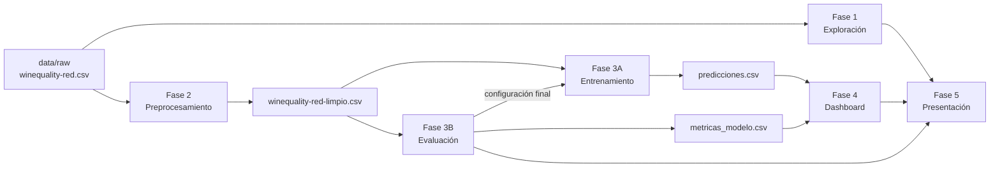

# Predicción de la calidad del vino tinto con Naive Bayes

| | |
|---|---|
| **Materia** | Ingeniería del Conocimiento |
| **Grupo** | 219900 |
| **Docente** | Ing. Rafael Hernández López |
| **Proyecto** | Proyecto final: Machine Learning (Naive Bayes) y Business Intelligence (Power BI) |
| **Entrega técnica** | 19 de noviembre de 2026 (repositorio y dashboard) |
| **Defensa** | 26 de noviembre de 2026 (presentación ejecutiva, traje formal) |

> **Antes de empezar:** lee [`INSTRUCCIONES_GENERALES.md`](./INSTRUCCIONES_GENERALES.md) (cómo trabajamos como equipo) y después la guía de tu fase en [`guias/`](./guias/).

---

## 1. Introducción

En la industria del vino, la calidad de un lote se decide tradicionalmente con una cata sensorial: un grupo de expertos prueba el vino y le asigna una calificación. Este método es valioso, pero tiene tres problemas: es **subjetivo**, es **costoso** y ocurre **al final del proceso**, cuando el vino ya está terminado y corregirlo es difícil o imposible.

Sin embargo, durante y después de la fermentación el laboratorio mide de forma rutinaria propiedades fisicoquímicas como la acidez, el alcohol, los sulfatos o el pH. Si esas mediciones contienen información sobre la calidad final, un modelo de aprendizaje automático puede **anticipar** qué lotes tienen riesgo de salir mal.

En este proyecto construimos ese modelo con **Naive Bayes**, un clasificador probabilístico basado en el teorema de Bayes, y llevamos sus resultados a un **dashboard de Power BI** para que una persona sin conocimientos de programación pueda tomar decisiones con él.

## 2. Problemática

Una bodega productora de vino tinto pierde dinero por la variabilidad en la calidad de sus lotes al terminar la fermentación. Hoy la calidad (escala de 0 a 10) se evalúa de forma manual y tardía mediante catas, lo que impide detectar a tiempo las desviaciones químicas que la provocan.

**Pregunta que guía el proyecto:** ¿podemos predecir, solo con mediciones de laboratorio, si un lote será de calidad buena o mala, con suficiente confianza como para priorizar qué lotes revisar primero?

## 3. Objetivos

### 3.1 Objetivo general

Desarrollar un clasificador **Gaussian Naive Bayes** que prediga si un lote de vino tinto tendrá calidad **buena** o **mala** a partir de sus 11 propiedades fisicoquímicas, e integrarlo en un **dashboard de Power BI** que permita a la bodega identificar los lotes en riesgo antes de su distribución.

### 3.2 Objetivos específicos

1. **Comprender los datos:** documentar el origen, la estructura y el significado químico de las 12 variables del dataset *Wine Quality*, e identificar sus problemas (duplicados, desbalance de clases).
2. **Preparar los datos:** construir un proceso de limpieza reproducible que elimine duplicados, homogenice el formato y transforme la variable `quality` en clases adecuadas para clasificar.
3. **Modelar:** entrenar y comparar distintas configuraciones de `GaussianNB` (tres clases, binario con 11 variables, binario con variables seleccionadas).
4. **Evaluar con rigor:** medir el desempeño con métricas adecuadas (accuracy, precision, recall, F1, matriz de confusión), validación cruzada y una línea base, sin fuga de datos.
5. **Comunicar al negocio:** construir un dashboard interactivo que traduzca las predicciones en indicadores accionables para la bodega.
6. **Concluir y defender:** interpretar los resultados, reconocer las limitaciones del modelo y presentarlos en una exposición ejecutiva de 30 minutos.

## 4. Datos

| Concepto | Valor |
|---|---|
| Dataset | *Wine Quality* (vino tinto), UCI Machine Learning Repository |
| Autores | Cortez, Cerdeira, Almeida, Matos y Reis (2009) |
| Archivo | `data/raw/winequality-red.csv` (no se modifica nunca) |
| Tamaño | 1,599 filas y 12 columnas (11 variables fisicoquímicas + `quality`) |
| Variable objetivo | `quality`: calificación sensorial, de 3 a 8 en la práctica |

---

## 5. Fases del proyecto

### 5.1 Resumen

| Fase | Nombre | Responsable | Recibe | Entrega |
|:---:|---|---|---|---|
| 1 | Origen y exploración de datos | Mateo | CSV crudo | Reporte de datos y diccionario de variables |
| 2 | Preprocesamiento | Pamela | CSV crudo | `winequality-red-limpio.csv` |
| 3A | Modelo: entrenamiento | Braulio | CSV limpio + configuración final de 3B | `predicciones.csv` |
| 3B | Modelo: evaluación y optimización | Octavio | CSV limpio | `metricas_modelo.csv` + configuración del modelo final |
| 4 | Dashboard de Business Intelligence | Ximena | `predicciones.csv` y `metricas_modelo.csv` | `dashboard_vino.pbix` + capturas |
| 5 | Conclusiones, presentación y defensa | Fátima | Resultados de todas las fases | Presentación y guion de defensa |

Las fases 1 a 3 se integran además en un **notebook común** (`notebooks/NaiveBayes.ipynb`) que escribimos entre todos, cada quien su sección.



### 5.2 Fase 1: Origen y exploración de datos

**Descripción.** Conocer a fondo el material con el que trabajamos antes de transformarlo: de dónde viene, qué mide cada columna, qué calidad tienen los datos y qué problemas habrá que resolver.

**Objetivo general.** Documentar el origen, la estructura y el contenido del dataset para que todo el equipo entienda qué representan los datos.

**Objetivos específicos.**
1. Identificar la fuente, los autores y el contexto del dataset.
2. Describir dimensiones, tipos de datos, valores nulos y duplicados.
3. Explicar el significado químico de cada variable y su efecto esperado en la calidad.
4. Analizar la distribución de `quality` y demostrar con números el desbalance de clases.

**Entregables.** `scripts/fase1_exploracion.py`, `docs/fase1_origen_datos.md`, figuras `docs/figuras/fase1_*.png`.

### 5.3 Fase 2: Preprocesamiento

**Descripción.** Convertir el CSV crudo en un dataset limpio, consistente y listo para modelar, con un script que cualquiera pueda volver a ejecutar y obtener el mismo resultado.

**Objetivo general.** Construir un proceso de limpieza reproducible que produzca el dataset con el que se entrenará el modelo.

**Objetivos específicos.**
1. Homogeneizar los nombres de columnas y los tipos de datos.
2. Verificar valores nulos y eliminar registros duplicados.
3. Analizar los valores atípicos y justificar su tratamiento.
4. Analizar las correlaciones entre variables y con la calidad.
5. Crear las variables objetivo `calidad_bin` (2 clases) y `calidad_3` (3 clases).
6. Exportar `data/processed/winequality-red-limpio.csv`.

**Entregables.** `scripts/fase2_preprocesamiento.py`, `data/processed/winequality-red-limpio.csv`, `docs/fase2_preprocesamiento.md`, figuras `docs/figuras/fase2_*.png`.

### 5.4 Fase 3: Modelo Naive Bayes

Esta fase se divide en dos partes que trabajan en paralelo y se comunican entre sí.

#### Fase 3A: Entrenamiento

**Descripción.** Construir el modelo: entender el teorema de Bayes, armar el pipeline de entrenamiento, ejecutar los experimentos y generar las predicciones que usará el dashboard.

**Objetivo general.** Implementar el clasificador `GaussianNB` dentro de un pipeline reproducible y generar las predicciones para todos los lotes.

**Objetivos específicos.**
1. Explicar el teorema de Bayes y el supuesto de independencia condicional.
2. Construir un `Pipeline` con `StandardScaler` y `GaussianNB`.
3. Entrenar los tres experimentos (3 clases, binario con 11 variables y binario con variables seleccionadas).
4. Generar predicciones y probabilidades honestas para los 1,359 lotes y exportar `predicciones.csv`.

**Entregables.** `scripts/fase3_entrenamiento.py`, `data/processed/predicciones.csv`, `docs/fase3_entrenamiento.md`.

#### Fase 3B: Evaluación y optimización

**Descripción.** Responder qué tan bueno es el modelo y cómo mejorarlo sin hacer trampa con los datos.

**Objetivo general.** Evaluar y optimizar el clasificador con métricas, validación cruzada y una línea base, y decidir la configuración del modelo final.

**Objetivos específicos.**
1. Definir una línea base para saber si el modelo realmente aprende.
2. Calcular accuracy, precision, recall, F1 y la matriz de confusión, e interpretarlas para el negocio.
3. Aplicar validación cruzada estratificada de 5 pliegues.
4. Seleccionar variables y ajustar `var_smoothing` usando solo datos de entrenamiento.
5. Comparar las configuraciones, decidir el modelo final y exportar `metricas_modelo.csv`.

**Entregables.** `scripts/fase3_evaluacion.py`, `data/processed/metricas_modelo.csv`, `docs/fase3_evaluacion.md`, figuras `docs/figuras/fase3_*.png`.

### 5.5 Fase 4: Dashboard de Business Intelligence

**Descripción.** Traducir las predicciones del modelo en una herramienta visual e interactiva para el jefe de calidad de la bodega.

**Objetivo general.** Construir en Power BI un dashboard de cuatro páginas que permita identificar y priorizar los lotes en riesgo.

**Objetivos específicos.**
1. Cargar y tipar correctamente los CSV de predicciones y métricas.
2. Programar medidas DAX para los indicadores de negocio y del modelo.
3. Diseñar cuatro páginas: resumen ejecutivo, perfil fisicoquímico, desempeño del modelo y explorador de lotes.
4. Documentar las medidas y la forma de uso del tablero.

**Entregables.** `docs/dashboard/dashboard_vino.pbix`, capturas `docs/dashboard/pagina*.png`, `docs/dashboard/guia_power_bi.md`.

### 5.6 Fase 5: Conclusiones, presentación y defensa

**Descripción.** Unir el trabajo de todos en una historia clara para el docente y para el negocio, y preparar al equipo para defenderla.

**Objetivo general.** Comunicar los resultados del proyecto en una presentación ejecutiva y coordinar la defensa en equipo.

**Objetivos específicos.**
1. Redactar las conclusiones de negocio, las limitaciones del modelo y el trabajo futuro.
2. Construir la presentación ejecutiva con los resultados y figuras de cada fase.
3. Elaborar el guion cronometrado de 30 minutos.
4. Reunir el banco de preguntas de defensa y asegurar que cada integrante sepa responder las de su fase.

**Entregables.** `docs/presentacion/Presentacion_Naive_Bayes.pptx`, `docs/presentacion/guion.md`.

---

## 6. Contrato de datos

Estos nombres de columnas son un acuerdo del equipo. Gracias a ellos cada fase puede empezar a trabajar **antes** de recibir el archivo de la fase anterior. Si alguien necesita cambiarlos, primero lo avisa al equipo.

**`data/processed/winequality-red-limpio.csv`** (Fase 2, 14 columnas)

```text
fixed_acidity, volatile_acidity, citric_acid, residual_sugar, chlorides,
free_sulfur_dioxide, total_sulfur_dioxide, density, ph, sulphates, alcohol,
quality, calidad_bin, calidad_3
```

| Columna | Valores |
|---|---|
| `calidad_bin` | `bueno` (quality >= 6) / `malo` (quality <= 5) |
| `calidad_3` | `baja` (<= 5) / `media` (= 6) / `alta` (>= 7) |

**`data/processed/predicciones.csv`** (Fase 3A): las 14 columnas anteriores más:

| Columna | Significado |
|---|---|
| `id_lote` | Identificador del lote, de 1 a 1,359 |
| `y_real` | Clase real (`bueno` / `malo`) |
| `y_pred` | Clase predicha por el modelo |
| `prob_bueno` | Probabilidad estimada de que el lote sea bueno (0 a 1) |
| `acierto` | 1 si `y_real == y_pred`, si no 0 |
| `lote_en_riesgo` | 1 si el modelo predice `malo`, si no 0 |

**`data/processed/metricas_modelo.csv`** (Fase 3B): dos columnas, `metrica` y `valor`, con estas filas:

```text
accuracy, precision_macro, recall_macro, f1_macro, accuracy_linea_base
```

## 7. Equipo, ramas y guías

| Integrante | Fase | Rama | Guía |
|---|---|---|---|
| Mateo | 1 | `mateo-fase1-origen-datos` | [Guía fase 1](./guias/fase1_mateo_origen_datos.md) |
| Pamela | 2 | `pamela-fase2-preprocesamiento` | [Guía fase 2](./guias/fase2_pamela_preprocesamiento.md) |
| Braulio | 3A | `braulio-fase3-entrenamiento` | [Guía fase 3A](./guias/fase3a_braulio_entrenamiento.md) |
| Octavio | 3B | `octavio-fase3-evaluacion` | [Guía fase 3B](./guias/fase3b_octavio_evaluacion.md) |
| Ximena | 4 | `ximena-fase4-dashboard` | [Guía fase 4](./guias/fase4_ximena_dashboard.md) |
| Fátima | 5 | `fatima-fase5-presentacion` | [Guía fase 5](./guias/fase5_fatima_presentacion.md) |

La forma de trabajar (commits, pull requests, turnos del notebook y comunicación) está en [`INSTRUCCIONES_GENERALES.md`](./INSTRUCCIONES_GENERALES.md).

## 8. Estructura del repositorio

```text
Naive-Bayes/
├── data/
│   ├── raw/winequality-red.csv        Dataset original (no se modifica)
│   └── processed/                     CSV generados por las fases 2 y 3
├── scripts/                           Un script por fase (fase1_..., fase2_..., fase3_...)
├── notebooks/NaiveBayes.ipynb         Notebook integrador (lo escribimos entre todos)
├── docs/
│   ├── figuras/                       Gráficas, con prefijo de la fase (fase1_..., fase3_...)
│   ├── dashboard/                     Fase 4: .pbix, capturas y guía de Power BI
│   ├── presentacion/                  Fase 5: .pptx y guion de defensa
│   └── faseN_*.md                     Reporte escrito de cada fase
├── guias/                             Guía de aprendizaje de cada fase
├── INSTRUCCIONES_GENERALES.md         Cómo trabajamos como equipo
├── requirements.txt                   Librerías de Python
└── README.md                          Este archivo
```

## 9. Resultados

Esta sección se completa al cerrar la fase 3B.

| Configuración | Accuracy | F1 macro |
|---|---|---|
| Línea base (clase mayoritaria) | Pendiente | n/a |
| 3 clases, 11 variables | Pendiente | Pendiente |
| Binario, 11 variables | Pendiente | Pendiente |
| Binario, variables seleccionadas (final) | Pendiente | Pendiente |

## 10. Cómo reproducir el proyecto

```bash
git clone https://github.com/XimenaBecOliv07/Naive-Bayes.git
cd Naive-Bayes
pip install -r requirements.txt
python scripts/fase2_preprocesamiento.py
python scripts/fase3_evaluacion.py
python scripts/fase3_entrenamiento.py
jupyter notebook notebooks/NaiveBayes.ipynb
```

## 11. Referencias

- Cortez, P., Cerdeira, A., Almeida, F., Matos, T., y Reis, J. (2009). Modeling wine preferences by data mining from physicochemical properties. *Decision Support Systems, 47*(4), 547-553. https://doi.org/10.1016/j.dss.2009.05.016
- UCI Machine Learning Repository: Wine Quality. https://archive.ics.uci.edu/dataset/186/wine+quality
- Pedregosa, F. et al. (2011). Scikit-learn: Machine Learning in Python. *Journal of Machine Learning Research, 12*, 2825-2830.
- Documentación de scikit-learn, Naive Bayes: https://scikit-learn.org/stable/modules/naive_bayes.html
