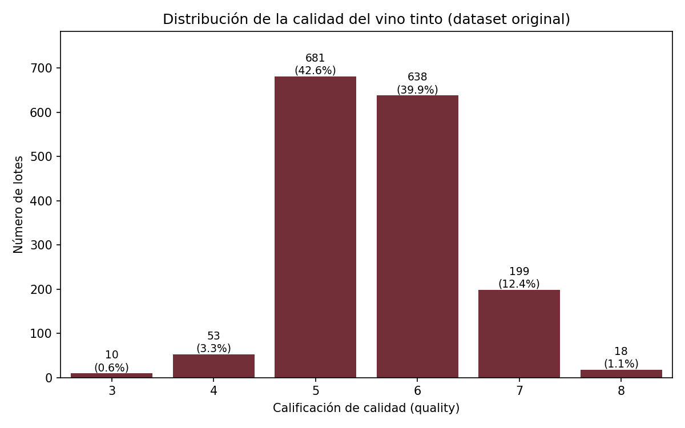

# Fase 1: Origen y exploración de datos

| | |
|---|---|
| **Responsable** | Mateo |
| **Proyecto** | Predicción de la calidad del vino tinto con Naive Bayes |
| **Materia** | Ingeniería del Conocimiento, grupo 219900 |
| **Script** | `scripts/fase1_exploracion.py` |
| **Figura** | `docs/figuras/fase1_distribucion_quality.png` |

## 1. Procedencia

| Concepto | Valor |
|---|---|
| Dataset | *Wine Quality*, variante de vino tinto |
| Repositorio | UCI Machine Learning Repository: https://archive.ics.uci.edu/dataset/186/wine+quality |
| Autores | Paulo Cortez, António Cerdeira, Fernando Almeida, Telmo Matos y Joaquim Reis |
| Año | 2009 |
| Origen de las muestras | Vino tinto *vinho verde* del norte de Portugal |
| Archivo en el repositorio | `data/raw/winequality-red.csv` (solo lectura) |

Cada fila es un lote de vino. Las primeras 11 columnas son mediciones de laboratorio (pruebas fisicoquímicas) y la última, `quality`, es la calificación sensorial: cada muestra la evaluaron al menos tres catadores expertos en una escala de 0 a 10 y se registró la mediana de sus calificaciones.

**Referencia:**
Cortez, P., Cerdeira, A., Almeida, F., Matos, T., y Reis, J. (2009). Modeling wine preferences by data mining from physicochemical properties. *Decision Support Systems, 47*(4), 547-553. https://doi.org/10.1016/j.dss.2009.05.016

### Por qué estos datos sirven para el problema de la bodega

Las mediciones fisicoquímicas se toman en el laboratorio durante y después de la fermentación, mucho antes de la cata final. Si esas mediciones contienen información sobre la calidad, un modelo puede **anticipar** qué lotes tienen riesgo de salir mal, cuando todavía hay tiempo de revisarlos.

## 2. Resumen técnico

Cifras obtenidas al ejecutar `python scripts/fase1_exploracion.py` desde la raíz del proyecto:

| Concepto | Valor |
|---|---|
| Filas (lotes) | 1,599 |
| Columnas | 12 (11 predictoras + 1 objetivo) |
| Tipos de datos | 11 columnas decimales (`float64`) y `quality` entera (`int64`) |
| Valores nulos | 0 |
| Filas duplicadas | 240 |
| Filas que quedan sin duplicados | 1,359 |

### Distribución de `quality`

| Calificación | Lotes | Porcentaje |
|:---:|---:|---:|
| 3 | 10 | 0.63% |
| 4 | 53 | 3.31% |
| 5 | 681 | 42.59% |
| 6 | 638 | 39.90% |
| 7 | 199 | 12.45% |
| 8 | 18 | 1.13% |
| **Total** | **1,599** | **100%** |

Aunque la escala va de 0 a 10, en los datos solo aparecen calificaciones del 3 al 8. Las calificaciones 5 y 6 juntas suman **1,319 lotes (82.49%)**.

### Estadísticas descriptivas

| Variable | Media | Mediana | Desv. estándar | Mínimo | Máximo |
|---|---:|---:|---:|---:|---:|
| fixed acidity | 8.320 | 7.900 | 1.741 | 4.600 | 15.900 |
| volatile acidity | 0.528 | 0.520 | 0.179 | 0.120 | 1.580 |
| citric acid | 0.271 | 0.260 | 0.195 | 0.000 | 1.000 |
| residual sugar | 2.539 | 2.200 | 1.410 | 0.900 | 15.500 |
| chlorides | 0.087 | 0.079 | 0.047 | 0.012 | 0.611 |
| free sulfur dioxide | 15.875 | 14.000 | 10.460 | 1.000 | 72.000 |
| total sulfur dioxide | 46.468 | 38.000 | 32.895 | 6.000 | 289.000 |
| density | 0.997 | 0.997 | 0.002 | 0.990 | 1.004 |
| pH | 3.311 | 3.310 | 0.154 | 2.740 | 4.010 |
| sulphates | 0.658 | 0.620 | 0.170 | 0.330 | 2.000 |
| alcohol | 10.423 | 10.200 | 1.066 | 8.400 | 14.900 |
| quality | 5.636 | 6.000 | 0.808 | 3.000 | 8.000 |

Lo que se lee en esta tabla:
- Las variables están en **escalas muy distintas**: `density` casi no varía (desviación de 0.002), mientras que `total sulfur dioxide` va de 6 a 289.
- En varias variables la media es mayor que la mediana y el máximo está muy lejos del resto (`residual sugar`, `chlorides`, `total sulfur dioxide`, `sulphates`). Eso indica **valores extremos** hacia arriba.

## 3. Diccionario de datos

La rúbrica habla de 12 atributos: son las 11 variables predictoras (lo que el modelo usa para predecir) más la variable objetivo `quality` (lo que se quiere predecir). Por eso el modelo trabaja con 11 entradas.

| # | Variable | Unidad | Qué mide | Cómo afecta al vino |
|:---:|---|---|---|---|
| 1 | `fixed acidity` | g de ácido tartárico / dm3 | Ácidos que vienen de la uva y no se evaporan (tartárico, málico). | Le dan estructura y frescura. Muy poca deja el vino plano; demasiada lo hace muy ácido. |
| 2 | `volatile acidity` | g de ácido acético / dm3 | Ácidos que sí se evaporan, sobre todo el ácido acético que producen bacterias durante la fermentación. | Es un **defecto**: en exceso el vino huele y sabe a vinagre. Se espera que a más acidez volátil, peor calidad. |
| 3 | `citric acid` | g / dm3 | Ácido cítrico, presente en cantidades pequeñas. | Aporta frescura y sabor. 132 lotes (8%) tienen 0. |
| 4 | `residual sugar` | g / dm3 | Azúcar que queda cuando termina la fermentación. | Define qué tan dulce es el vino. Casi todos los lotes son secos (mediana de 2.2 g/dm3). |
| 5 | `chlorides` | g de cloruro de sodio / dm3 | Cantidad de sal. | En exceso el vino sabe salado; valores altos pueden indicar un problema en el proceso. |
| 6 | `free sulfur dioxide` | mg / dm3 | Dióxido de azufre (SO2) libre, la parte que todavía está activa. | Protege al vino contra microbios y contra la oxidación. |
| 7 | `total sulfur dioxide` | mg / dm3 | SO2 libre más el SO2 que ya se unió a otras moléculas del vino. | Una cantidad moderada conserva el vino; en exceso se percibe un olor picante a azufre. |
| 8 | `density` | g / cm3 | Densidad del vino comparada con la del agua. | Depende sobre todo del alcohol (lo hace menos denso) y del azúcar (lo hace más denso). |
| 9 | `pH` | escala de 0 a 14 | Qué tan ácido es el vino; en estos datos va de 2.74 a 4.01. | Un pH bajo hace al vino más estable y ayuda a que el SO2 funcione mejor. |
| 10 | `sulphates` | g de sulfato de potasio / dm3 | Sulfatos, un aditivo del vino. | Ayudan a aumentar el SO2, que actúa como antimicrobiano y antioxidante. |
| 11 | `alcohol` | % del volumen | Porcentaje de alcohol producido en la fermentación. | Da cuerpo al vino. Se espera que los vinos con más alcohol reciban mejores calificaciones. |
| 12 | `quality` | escala de 0 a 10 | Mediana de las calificaciones de al menos tres catadores. | **Variable objetivo**: es lo que el modelo tiene que predecir. |

## 4. Hallazgos y qué implican para las siguientes fases

### 4.1 No hay valores nulos
Las 1,599 filas tienen las 12 columnas completas. No hace falta rellenar ni eliminar datos faltantes.

### 4.2 Hay 240 filas duplicadas
Son filas idénticas en las 12 columnas. Si se dejan, al dividir los datos en entrenamiento y prueba una copia puede quedar de cada lado: el modelo "ya vio" ese lote al entrenar y acierta en la prueba sin mérito, lo que **infla el accuracy**.

**Para la fase 2:** eliminar los duplicados antes de cualquier otra cosa. Quedan **1,359 lotes**.

### 4.3 Las clases de `quality` están desbalanceadas
El 82.49% de los lotes tiene calificación 5 o 6. En cambio, solo hay 10 lotes con calificación 3 y 18 con calificación 8. Con tan pocos ejemplos, el modelo no tiene de dónde aprender cómo es un vino de 3 o de 8, y tiende a predecir siempre las clases que más se repiten.

**Para las fases 2 y 3:** por eso el equipo agrupa `quality` en clases más grandes (ver contrato de datos del README):

| Columna | Regla | Lotes después de quitar duplicados |
|---|---|---|
| `calidad_bin` | `bueno` si quality >= 6, `malo` si quality <= 5 | 719 bueno y 640 malo |
| `calidad_3` | `baja` <= 5, `media` = 6, `alta` >= 7 | 640 baja, 535 media y 184 alta |

El corte binario en 6 deja dos clases casi del mismo tamaño, lo que hace al problema mucho más manejable.

### 4.4 Las variables están en escalas distintas y tienen valores extremos
Como se ve en las estadísticas descriptivas, unas variables van de 0.99 a 1.00 y otras de 6 a 289, y varias tienen máximos muy alejados de la mediana.

**Para la fase 2:** revisar los valores extremos con diagramas de caja y decidir si son errores o lotes reales que el modelo debe aprender a reconocer. El escalado no se hace en el CSV limpio: le corresponde al pipeline del modelo en la fase 3.

### 4.5 Las mediciones permiten predecir temprano
Las 11 variables se miden en el laboratorio antes de la cata. Si el modelo logra relacionarlas con la calidad, la bodega puede identificar lotes en riesgo antes de distribuirlos, que es justo el objetivo del proyecto.
