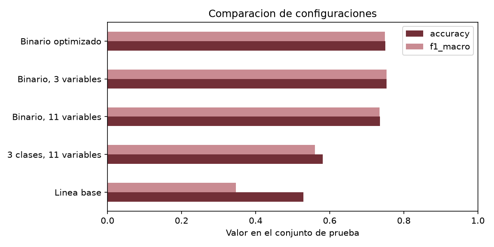
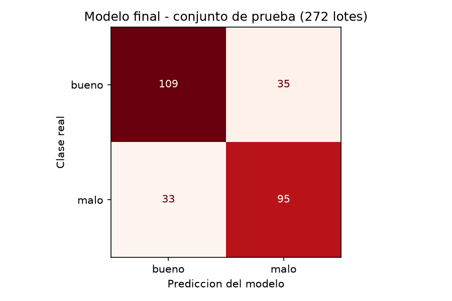

# Fase 3B: Evaluacion y optimizacion del modelo

**Responsable:** Octavio
**Rama:** `octavio-fase3-evaluacion`
**Script:** `scripts/fase3_evaluacion.py`

## 1. Metodologia

- Division 80/20 estratificada con `random_state=42` (1087 entrenamiento, 272 prueba), igual que la fase 3A.
- Todas las decisiones (variables y `var_smoothing`) se tomaron con validacion cruzada estratificada de 5 pliegues sobre entrenamiento. El conjunto de prueba solo se uso para la medicion final.

## 2. Linea base

`DummyClassifier` que siempre predice la clase mas frecuente (`bueno`): accuracy `0.5294`, F1 macro `0.3462`.

La linea base sirve como referencia minima: en un conjunto desbalanceado o ligeramente inclinado hacia una clase, predecir siempre la clase mayoritaria consigue 52.94 % de aciertos sin aprender nada sobre la quimica del vino (su F1 macro cae a 0.3462 porque nunca detecta lotes malos). Cualquier modelo util debe superar con margen esta referencia.

## 3. Seleccion de variables

Correlacion absoluta con `quality`, calculada solo con entrenamiento:

| Variable | abs(r) |
|---|---:|
| alcohol | 0.478 |
| volatile_acidity | 0.401 |
| sulphates | 0.263 |
| citric_acid | 0.217 |
| density | 0.186 |

| Variables | F1 CV | Accuracy prueba | F1 prueba |
|---:|---:|---:|---:|
| 3 | 0.7239 | 0.7537 | 0.7531 |
| 5 | 0.7080 | 0.7426 | 0.7426 |
| 7 | 0.7177 | 0.7426 | 0.7420 |
| 9 | 0.7099 | 0.7500 | 0.7497 |
| 11 | 0.7134 | 0.7353 | 0.7346 |

Se eligieron 3 variables (`alcohol`, `volatile_acidity` y `sulphates`) por obtener el mayor F1 macro en validacion cruzada (`0.7239`). Al eliminar las 8 variables menos correlacionadas y con mayor colinealidad entre si (`fixed_acidity`, `ph`, `density`, `citric_acid`, `free/total_sulfur_dioxide`), se reduce la redundancia que perjudica el supuesto de independencia condicional de Naive Bayes.

## 4. Ajuste de var_smoothing

`GridSearchCV` con `np.logspace(-9, 2, 23)`. Mejor valor: `1.0` (F1 CV `0.7368`).

`var_smoothing` suma una fraccion de la varianza maxima observada a las varianzas estimadas de cada variable dentro de cada clase. Al aumentarlo a `1.0`, se suavizan las curvas gaussianas frente a valores atipicos y asimetrias (por ejemplo, en `sulphates`), evitando probabilidades extremas poco calibradas. Aunque en el conjunto de prueba de 272 lotes el accuracy paso de `0.7537` (205 aciertos) a `0.7500` (204 aciertos, una diferencia de solo 1 lote), la decision se toma siempre con validacion cruzada sobre los 1,087 lotes de entrenamiento (`0.7239` -> `0.7368` en F1 CV) para no sobreajustar al conjunto de prueba.

## 5. Comparacion de configuraciones

| Modelo | Accuracy | F1 macro |
|---|---:|---:|
| Linea base | 0.5294 | 0.3462 |
| 3 clases, 11 variables | 0.5809 | 0.5596 |
| Binario, 11 variables | 0.7353 | 0.7346 |
| Binario, 3 variables | 0.7537 | 0.7531 |
| Binario optimizado (final) | 0.7500 | 0.7493 |

El enfoque binario (`bueno` vs `malo`) supera ampliamente al de 3 clases (`0.7500` frente a `0.5809` en accuracy y `0.7493` frente a `0.5596` en F1 macro) porque en el esquema de 3 clases la categoria `alta` (`quality >= 7`) representa apenas 13.5 % de los lotes y la clase `media` (`quality == 6`) se traslapa quimicamente tanto con `baja` como con `alta`. Al reagrupar en dos clases casi balanceadas (52.9 % `bueno`, 47.1 % `malo`), la frontera de decision resulta mucho mas clara y alineada con el objetivo de detectar lotes en riesgo.

## 6. Modelo final

- Variables: `alcohol`, `volatile_acidity`, `sulphates`
- `var_smoothing`: 1.0
- Prueba: accuracy 0.7500, precision macro 0.7492, recall macro 0.7496, F1 macro 0.7493

|  | Predice bueno | Predice malo |
|---|---:|---:|
| Es bueno | 109 | 35 |
| Es malo | 33 | 95 |

Para la bodega, el error mas costoso son los **33 falsos negativos** (lotes realmente malos que el modelo clasifica como buenos), porque implican riesgo de embotellar y distribuir vino defectuoso, generando devoluciones y dano a la reputacion de la marca. En cambio, los **35 falsos positivos** (lotes buenos marcados en riesgo) tienen un costo manejable, ya que solo pasan a una cata de verificacion antes de aprobarse. Por ello, el modelo debe usarse como un sistema de triaje preventivo en laboratorio, priorizando la cata sensorial de los lotes con menor `prob_bueno`.

## 7. Limitaciones

El modelo alcanza 75.00 % de accuracy y no cifras cercanas a 95 % por cuatro razones principales:

1. **Subjetividad de la etiqueta `quality`:** proviene de catas humanas que perciben aromas, taninos y defectos sensoriales no capturados por las 11 mediciones quimicas de laboratorio.
2. **Supuestos de `GaussianNB`:** asume normalidad e independencia condicional entre variables; aunque seleccionar 3 variables mitiga la colinealidad, variables como `sulphates` presentan sesgo positivo.
3. **Frontera discretizada:** la mayoria de los vinos se concentra en calificaciones 5 y 6, cuyos perfiles quimicos son muy cercanos entre si.
4. **Tamano de la muestra:** tras eliminar duplicados quedan 1,359 lotes (1,087 en entrenamiento), lo cual limita la precision con que se pueden separar casos fronterizos.
